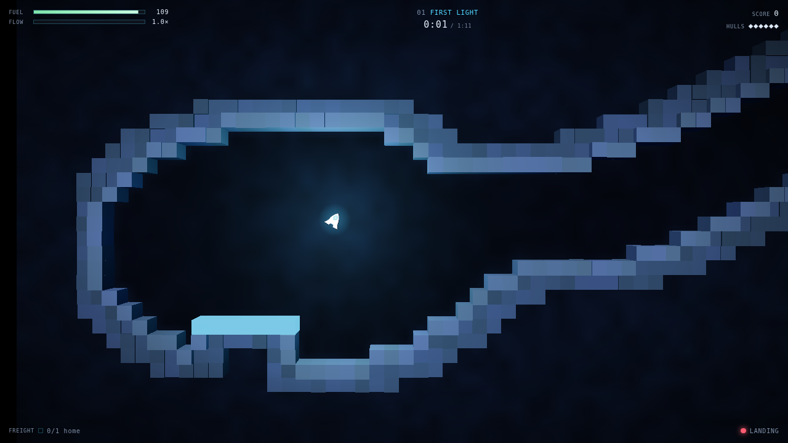
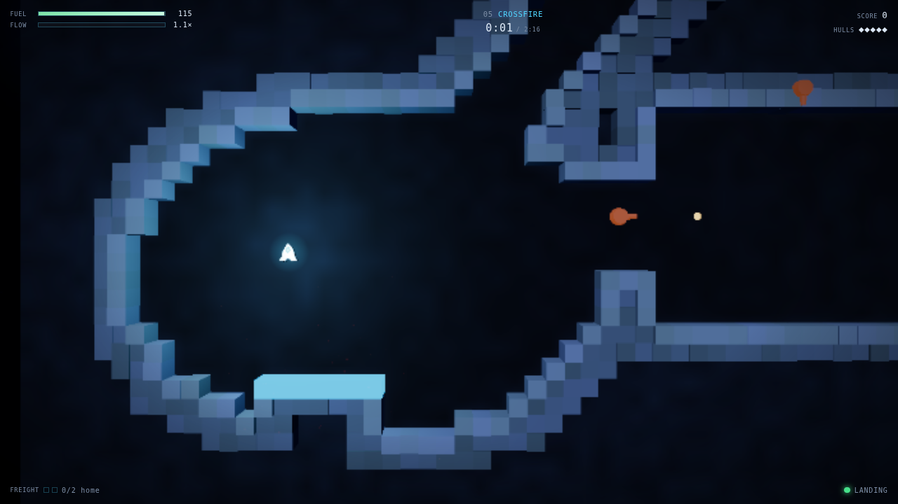
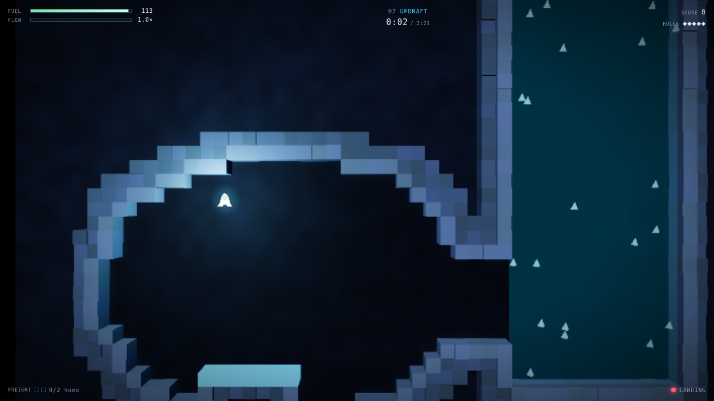
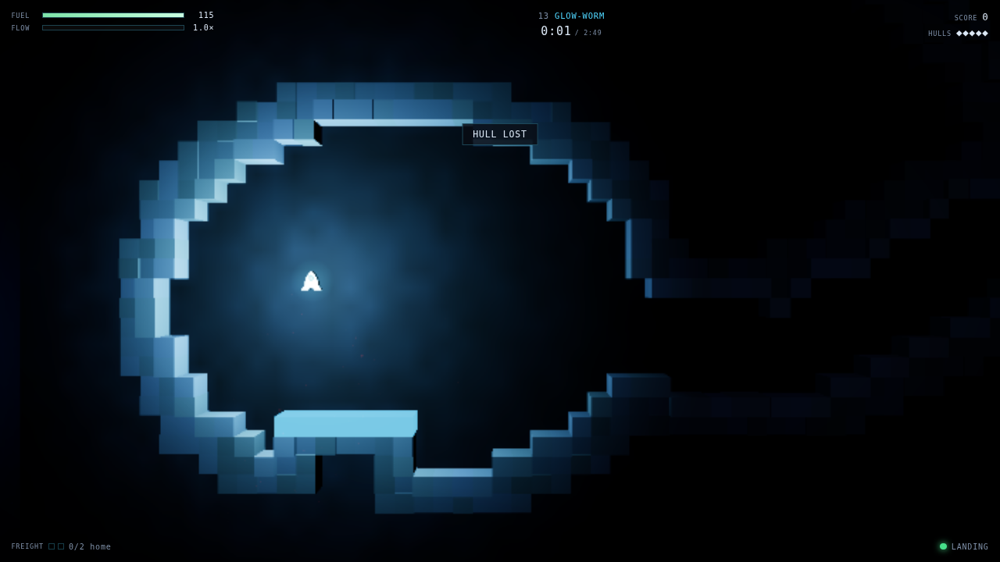
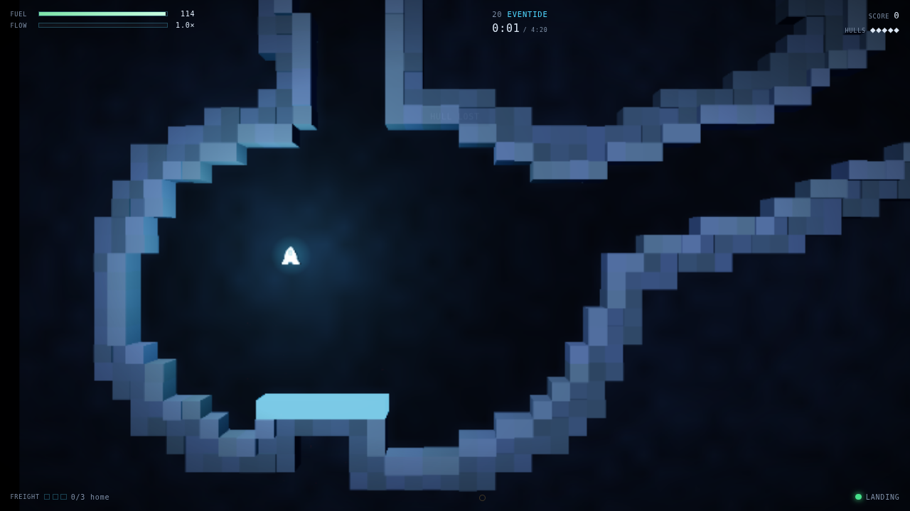

# Gravity Hauler

A gravity cave flyer built with Three.js and TypeScript — a modern take on the
1996 Windows shareware game *Crazy Gravity* by Axel Meierhöfer (XLM Software),
which itself descends from *Thrust* (1986) and Atari's *Gravitar*.

Rotate the ship, burn the engine along its nose, fight a constant downward pull,
pick up freight and put it down softly on the base pad. The rock is always fatal.



<table>
<tr>
<td></td>
<td></td>
</tr>
<tr>
<td></td>
<td></td>
</tr>
</table>

> Screenshots are captured from the built bundle in a real Chromium, but under
> SwiftShader software rasterisation — the quality system therefore steps bloom
> off before the shot is taken. On hardware the emissive surfaces glow.

> **On the name and the content.** Game mechanics are not copyrightable, but
> names, art, sound and level layouts are. Nothing here is taken from the
> original: the title, the twenty caves, the passwords, the ship, every sound
> and every line of code are original work. "Crazy Gravity" is also an unrelated
> 2021 Steam title, which is a second good reason not to reuse the name.

---

## Play

```bash
npm install
npm run dev            # http://127.0.0.1:5173
```

```bash
npm run build          # type-check + production bundle into dist/
npm run preview        # serve the built bundle
```

### Controls

| | |
|---|---|
| <kbd>A</kbd> / <kbd>←</kbd> | rotate left |
| <kbd>D</kbd> / <kbd>→</kbd> | rotate right |
| <kbd>W</kbd> / <kbd>↑</kbd> / <kbd>Space</kbd> | thrust along the nose |
| <kbd>S</kbd> / <kbd>↓</kbd> | auto-level assist |
| <kbd>R</kbd> | restart the cave |
| <kbd>Esc</kbd> / <kbd>P</kbd> | pause |
| <kbd>M</kbd> | mute |
| <kbd>F3</kbd> | debug overlay |

Gamepads work too — left stick or d-pad to turn, A or right trigger to thrust.

Thrust only ever fires along the nose. To slow down you have to turn around
first, and that turn is the entire game.

---

## What it takes from 1996, and what it does differently

Faithful to the original's design:

- **Rotate-and-thrust only.** No directional control, no braking key.
- **Wall contact is death.** Pads are the only soft surface.
- **The full resource set:** fuel, a time target, a hull count, coloured keys
  and gates, freight waiting versus freight aboard, and the green / yellow / red
  landing indicator.
- **Five difficulty tiers, twenty caves, and per-level passwords.**
- **Hazards from the original's roster:** cannons, magnets, blowers, moving
  rods, one-way sluices and locked colour gates.

Deliberately modern:

- **Flow.** Skimming close to rock *at speed* fills a meter that multiplies your
  score and trickles fuel back. The original punished proximity and rewarded
  nothing for skirting it; here the fastest line is also the most dangerous one,
  which turns a punishing game into a risk/reward loop without softening it.
- **Cargo mass is a decision.** You can carry three crates, but each one makes
  the hull heavier and lazier. Haul all three in one trip or shuttle twice —
  that is a real choice, not a formality.
- **Retry latency near zero.** <kbd>R</kbd> restarts instantly, respawn after a
  crash takes under a second, and delivered freight and collected keys stay
  banked. Death costs a hull, not your progress.
- **Difficulty never gates content.** Rookie plays all twenty caves; the tiers
  change gravity, fuel, hazard tempo and landing tolerance — and your score
  multiplier — not the level list.
- **Locked gates bump instead of killing.** Grey rock kills, coloured tech
  pushes you back, red crystal kills. A consistent visual language means a
  mechanic can teach itself without a death.
- **One new idea per cave.** Each of the first thirteen levels introduces
  exactly one mechanic in a safe room before it is ever combined.
- **Medals and a par time** instead of a hard timer — except on Veteran and
  Legend, where the clock does bite.
- **Autosave**, so passwords are a convenience rather than homework.

---

## Architecture

```
src/
  sim/          simulation - no DOM, no Three.js, runs in node
    config.ts     every tuning constant in one table
    types.ts      tile codes, input frame, event types
    level.ts      the carve DSL, the baker, the validator
    levels.ts     the twenty caves
    collision.ts  circle vs tile grid, sub-stepping, wall proximity
    world.ts      entities and stepWorld()
  app/          orchestration
    loop.ts       fixed timestep + interpolated rendering
    input.ts      keyboard and gamepad -> InputFrame
    save.ts       localStorage progress
    game.ts       state machine wiring everything together
  render/       Three.js views over the simulation
    scene.ts      renderer, camera rig, bloom
    terrain.ts    instanced cave geometry
    actors.ts     ship and props
    particles.ts  one pooled additive point cloud
    backdrop.ts   parallax layers
  ui/           DOM overlay
    hud.ts, screens.ts
  audio/        procedural WebAudio, no sample files
tests/          vitest unit + integration, playwright end-to-end
```

The dependency arrow only ever points one way: `sim` knows nothing about
`render`, `ui`, `app` or the browser. That is what lets the whole game be
simulated headlessly in tests.

### Simulation

Fixed 120 Hz timestep with an accumulator and a `dt` clamp; rendering is
decoupled and interpolates between the last two states. Integration is
semi-implicit (symplectic) Euler — stable, cheap, and energy-behaved enough for
a gravity game, where explicit Euler visibly drifts.

Collision is a circle against the tile grid. Movement is sub-stepped so the hull
can never skip a one-tile wall at the speed cap; there is a unit test that fires
the ship at a single solid column at maximum velocity and asserts it dies on the
near side.

### How levels are authored

Levels are not painted tile by tile. Each starts as solid rock, and a short list
of shapes — rooms, elliptical caverns, polyline tubes — is subtracted from it. A
seeded value-noise field perturbs every carve boundary, so the result reads as
an organic cave instead of a rectangle collage while the source data stays small
enough to diff:

```ts
{
  name: 'First Light',
  carve: [
    { t: 'cave', cx: 20, cy: 14, rx: 13, ry: 8 },
    { t: 'cave', cx: 70, cy: 30, rx: 12, ry: 9 },
    tube(3.2, [20, 14], [44, 17], [70, 30]),
  ],
  pads: [{ x: 13, y: 8, w: 7, kind: 'base' }],
  objects: [{ t: 'cargo', x: 70, y: 28 }],
}
```

Baking is deterministic — same spec in, byte-identical grid out — which is what
makes the validator and the replayable autopilot trustworthy. `validateLevel`
flood-fills from the spawn and fails the build if any crate, key or pad is
unreachable, if a pad is too narrow to land on, or if a gate colour has no key.

### Rendering

The 2D playfield is drawn as a 3D relief: solid tiles are boxes extruded towards
the camera, open space is the dark floor between them. The camera is perspective
rather than orthographic on purpose — the slight parallax on wall flanks near
the screen edge is what makes a tile grid read as a cavern.

A whole level is a handful of draw calls (instanced rock, instanced pads,
instanced spikes, floor plane) plus one pooled point cloud for every particle in
the game. Only rock within two tiles of open space is instanced at all — the
mass behind the cave wall is painted onto the floor slab from a texture built
straight out of the tile grid, which cuts the geometry roughly fivefold without
changing what you see. Unlit levels dim the global lights and leave only the
ship's lamp.

Quality steps itself down automatically after a sustained slow patch: first
bloom, then the buffer resolution. On software rendering the game stays
playable, it just stops glowing.

---

## Testing

```bash
npm test               # vitest: unit + headless integration
npm run e2e            # playwright: real browser, real WebGL
```

**Unit** (`tests/physics.test.ts`) covers free fall against the analytic
solution, hover equilibrium, the speed cap, frame-rate independence, fuel burn,
the auto-level controller, contact normals, anti-tunneling, landing versus
crashing at the tolerance boundary, difficulty-scaled tolerance, respawn
semantics, and the flow meter's earn and decay rules.

**Level validation** (`tests/levels.test.ts`) bakes all twenty caves and asserts
each one is structurally valid, deterministic, fully connected from the spawn,
and sealed by a solid border.

**Integration** (`tests/integration.test.ts`) flies levels end to end with a
scripted pilot (`tests/autopilot.ts`) that plans routes with Dijkstra over the
tile grid and follows them with a PD thrust-vector controller. It exercises the
real loop: routing, keys and gates in order, one-way sluices, magnets, blowers,
refuelling, cargo mass, delivery, scoring and the clear condition.

Its scope is stated honestly in the test file. It finishes **13 of the 20 caves
with timing hazards disabled** and **8 of those with every hazard live**. The
seven it does not finish (3, 7, 10, 11, 13, 14, 17) are a limitation of the
pilot, not evidence those caves are unwinnable — it follows a static route and
loses time in long fuel-critical tunnels and dies at sharp bends in narrow
tubes. Their geometry is covered instead by the reachability validator.

**End to end** (`tests/e2e/smoke.spec.ts`) drives a real Chromium: WebGL boots,
the menus navigate, keyboard flight actually moves the ship and burns fuel,
gravity pulls it back down, pause genuinely freezes the simulation, restart
resets it, passwords unlock caves, progress survives a reload, and — on the
largest level — simulated time keeps pace with wall time while the quality
system steps itself down. That last one runs on SwiftShader, a software
rasteriser around two orders of magnitude slower than a GPU, so it asserts the
property that matters (the simulation does not stall or run fast) rather than a
frame count that would mean nothing on real hardware.

### Bugs these tests actually caught

Worth recording, because each one was a design flaw rather than a typo:

- The autopilot could not land at all. A "thrust when demand exceeds a
  threshold" rule is a bang-bang controller whose equilibrium sits at a
  *positive* climb rate — it hovers forever and can never touch down. Replacing
  it with PWM-modulated thrust fixed it.
- A clamp that stopped the nose from turning past ±77° made it impossible to
  thrust downwards, which is the only way to stop climbing inside an updraft.
- The route planner happily pathed backwards through one-way sluices, wedging
  the ship against a membrane it could never re-enter.
- Manhattan-distance clearance has a discontinuous gradient; steering off it
  chattered so badly the alignment gate never opened and the ship hung in place
  with the engine off. A chamfer distance transform fixed it.
- A pad's rock foundation sealed the only tunnel into a chamber in level 14 —
  caught by the reachability validator before it ever reached a player.
- `lives: 1` gave two attempts, off by one.
- The particle shader patch declared an attribute named `size`, which collides
  with `PointsMaterial`'s own uniform and fails to compile. Only a real browser
  finds that.
- The game loop capped catch-up at 8 sub-steps, which silently ran the
  simulation in slow motion on a slow renderer instead of just dropping frames.
- Distance fog was configured in world units without accounting for the camera
  sitting ~44 units back, so the unlit level rendered as a completely black
  screen. Only a screenshot finds that.
- A `SpriteMaterial` with no map is a hard square, so the ship's "halo" was a
  cyan box.
- The results card scaled the total by the difficulty multiplier but printed
  unscaled rows, and omitted freight and key points entirely — an itemised
  table whose rows did not add up to its own total.

Playtesting the autopilot runs also changed three level designs: level 7's
blowers were producing a 2 g net updraft that pinned you to the ceiling, level
13's tunnel was too long for a single refuel pad at the far end, and level 3
started with too little fuel to reach the first pad with any margin.

---

## Licence

MIT. See `LICENSE`.
